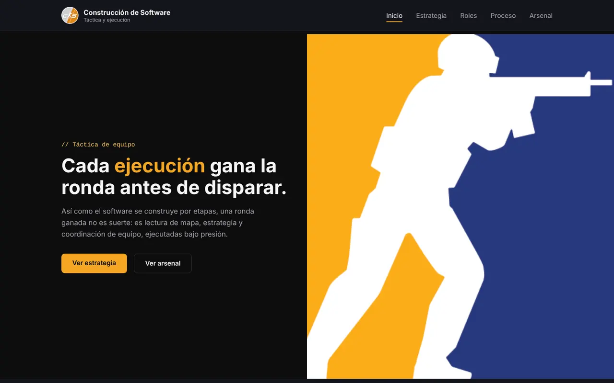
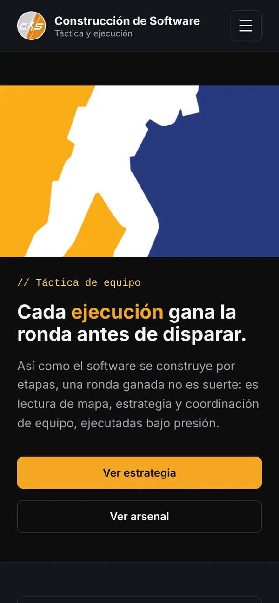

# Construcción de Software · Táctica y ejecución

Landing de una sola página que explica cómo se construye software usando la metáfora de una ronda de Counter-Strike: primero se lee el mapa (estrategia), luego cada quien cumple su rol, se sigue un proceso de la compra al repaso y se elige el equipo adecuado (arsenal).

Empezó como laboratorio de la materia **Construcción de Software** (Universidad Santo Tomás, Tunja) y luego se completó para el portafolio.

**Sitio publicado:** https://landing-cs-kyotto44.netlify.app

| Escritorio | Móvil |
| --- | --- |
|  |  |

## Funcionalidades

- **Navegación por secciones con scroll suave.** El header queda fijo y los enlaces llevan a cada sección sin que el título quede escondido detrás de él.
- **Menú móvil.** En pantallas de 768px o menos, los enlaces se agrupan en un panel que abre un botón. Se cierra con Escape, al tocar fuera, al elegir una sección o al salir con Tab.
- **Sección activa en el menú (scroll-spy).** Mientras recorres la página, el enlace de la sección que estás leyendo se resalta.
- **Terminal que se escribe sola.** Al llegar a la consola, los comandos aparecen letra por letra y la última línea se muestra como la respuesta del programa.
- **Filtros del arsenal.** Los botones *Todo / Armas / Utilidad* muestran solo esa categoría, como el menú de compra del juego, y cada uno indica cuántos elementos tiene.
- **Aparición en orden.** Los roles y los pasos del proceso aparecen uno tras otro al llegar a ellos, para reforzar que son una secuencia.
- **Accesible:** enlace "Saltar al contenido", foco visible, todo se puede usar con teclado, y si el sistema tiene activado "reducir movimiento" no hay animaciones de desplazamiento.
- **Funciona sin JavaScript:** el contenido completo se ve igual; solo se pierden las mejoras interactivas.

## Tecnologías

- HTML5 semántico.
- CSS propio, dividido en módulos dentro de `css/` y cargados en orden desde `css/estilos.css`.
- JavaScript sin librerías ni frameworks (`IntersectionObserver`, Web Animations API), un archivo por funcionalidad en `js/`.
- Imágenes en formato WebP.

## Cómo abrirlo

No necesita instalación ni servidor:

1. Descarga o clona el proyecto.
2. Abre `index.html` con doble clic en cualquier navegador moderno.

También funciona con la extensión **Live Server** de VS Code (clic derecho sobre `index.html` → *Open with Live Server*).

## Estructura de carpetas

```
landing-cs/
├── index.html            Página única
├── css/
│   ├── estilos.css       Punto de entrada: importa los demás módulos en orden
│   ├── reset.css         Normalización del navegador
│   ├── variables.css     Colores, tipografías, espaciados y tiempos de animación
│   ├── base.css          Estilos generales y contenedor
│   ├── header.css        Cabecera fija, menú y botón del menú móvil
│   ├── hero.css          Primera pantalla, botones y terminal
│   ├── componentes.css   Arsenal, filtros, cierre y pie de página
│   ├── secciones.css     Estrategia, roles y proceso
│   ├── animaciones.css   Aparición en orden al hacer scroll
│   ├── responsive.css    Adaptación a tablet y móvil
│   └── accesibilidad.css Enlace de salto, foco visible y movimiento reducido
├── js/
│   ├── menu.js           Abre y cierra el menú móvil
│   ├── scrollspy.js      Resalta la sección activa en el menú
│   ├── terminal.js       Escritura animada de la consola
│   ├── arsenal.js        Filtros por categoría del arsenal
│   └── revelar.js        Aparición de roles y pasos del proceso
├── imagenes/             Imágenes WebP, favicon y icono para iOS
├── docs/                 Capturas usadas en este README
└── netlify.toml          Cabeceras de seguridad y caché para Netlify
```

## Seguridad

Es un sitio estático: no tiene servidor, base de datos, claves de API ni funciones en la nube, así que no hay nada que un bot pueda usar para gastar recursos o leer datos.

- `netlify.toml` agrega cabeceras de seguridad en Netlify: una política de contenido (`Content-Security-Policy`) que solo permite los recursos que el sitio usa, bloqueo para que otras páginas no lo metan en un `iframe`, `nosniff`, HTTPS obligatorio y caché para las imágenes.
- Solo carga archivos propios: no usa CDN, fuentes externas, formularios ni servicios de terceros.

## Créditos

- Las imágenes son de terceros y se usan con fines educativos. Las armas, granadas, personajes, el radar del mapa y los logotipos provienen de **Counter-Strike 2** o se basan en su identidad visual; son propiedad de **Valve Corporation**. Este proyecto no tiene fines comerciales ni está afiliado a Valve.
- Proyecto académico de la materia Construcción de Software, Universidad Santo Tomás, Tunja.
